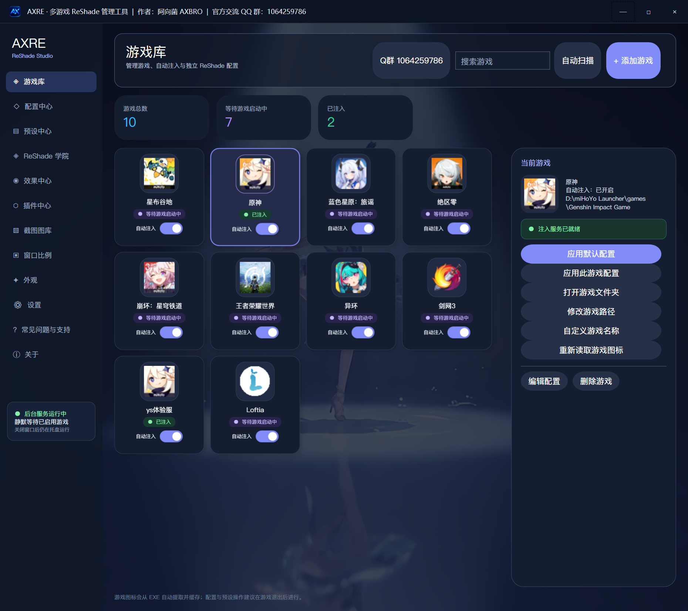

# AXRE Studio Beta

> 让游戏调色、渲染与截图变得简单。

AXRE Studio 是由 **阿向菌 AXBRO** 制作的 Windows 多游戏 ReShade 管理工具。它把游戏管理、ReShade 配置、效果学习、插件说明、截图图库和常见问题集中在一个中文界面中，主要面向游戏截图、虚拟摄影和画面调色用户。

> 当前仍处于 Beta 测试阶段。请先阅读风险说明，并优先在单机游戏或明确允许第三方图形工具的环境中使用。

## 主要功能

- 游戏库：扫描或手动添加游戏，并读取游戏图标。
- 自动注入：按游戏保存独立 ReShade 配置并等待游戏启动。
- 配置与预设：在不同游戏之间迁移经过验证的配置。
- 效果中心：按中文名或英文名搜索效果，并提供双语参数映射。
- 插件中心：查看 Add-on 用途、使用方法、状态和快捷键信息。
- 截图图库：管理 ReShade 截图、原图/处理后对比及效果拆解组。
- ReShade 学院：用白话和例图解释效果、贴图、插件及深度缓冲。
- 调试场景：使用轻量场景观察效果与深度相关功能。
- DLSS 5 专区：提供兼容说明和上游项目入口，不分发 NVIDIA 专有运行库。
- 窗口比例：实验性功能；不同游戏支持程度不同。

## 下载

最新公开测试包发布在本仓库的 **Releases** 页面。请勿从不明转载链接下载。

发布包会同时提供 SHA-256 校验值。Beta 测试签名不属于公开受信任证书，Windows 仍可能显示“未知发布者”。

公开版采用最小合规效果库，不包含作者自用的完整 Shader、Texture 与 Preset。其他效果请根据原作者许可从可信上游自行安装。

## 快速开始

1. 从 Releases 下载最新 Beta 安装包并核对 SHA-256。
2. 安装后启动 AXRE Studio。
3. 自动扫描游戏，或在“游戏库”中手动选择游戏 EXE。
4. 首次使用先点击“应用默认配置”。
5. 开启“自动注入”，保持 AXRE 在后台等待，再用游戏原本的启动方式进入游戏。
6. 游戏内按 ReShade 默认快捷键打开界面；具体快捷键以当前配置为准。

完整说明见 [安装指南](docs/INSTALL.md) 和 [使用教程](docs/USER-GUIDE.md)。

## 使用风险

- AXRE、ReShade 与任何游戏厂商均无隶属、赞助或官方认可关系。
- 第三方图形注入可能被反作弊或联网保护机制阻止，也可能违反部分游戏的用户协议。
- 不建议在竞技、排名或明确禁止注入工具的联网游戏中使用。
- 游戏更新后，注入、深度缓冲、效果或插件可能暂时失效。
- 请备份重要预设和截图。不要把来源不明的 DLL 放入游戏目录。

## 开源与许可

本仓库用于发布文档、版本信息和问题反馈。AXRE 自有程序当前不是开源软件；仓库不公开 AXRE 源码、签名私钥、混淆映射或完整效果库。

ReShade、插件及效果文件仍分别受其原作者许可证约束。详见 [第三方来源与许可](THIRD-PARTY-NOTICES.md) 和 [AXRE 许可](LICENSE.md)。

## 反馈与交流

- 官方交流 QQ 群：`1064259786`
- 作者：阿向菌 AXBRO
- Bilibili：[阿向菌 AXBRO](https://space.bilibili.com/436127696)
- 问题反馈：请使用本仓库的 Issues，并附上 AXRE 版本、游戏、启动方式和已脱敏日志。
