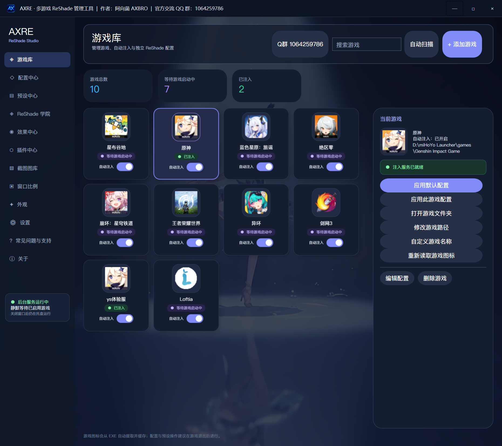

# AXRE Studio Beta

[简体中文](README.md) | [English](README_EN.md)

> Making game color grading, rendering, and screenshots easier.

AXRE Studio is a Windows multi-game ReShade manager created by **AXiangJun AXBRO**. It brings game management, ReShade configuration, effect learning, add-on documentation, screenshot galleries, and troubleshooting into one interface for game photography and visual customization.

> Technical note: AXRE is built around the ReShade injector mechanism. It externally loads ReShade into a selected game and then manages games, configurations, resource paths, add-ons, and screenshots. AXRE is not a standalone graphics-injection core and is not an official ReShade product. The ReShade project and its authors do not endorse, warrant, or provide support for AXRE.

> AXRE is currently in Beta. Back up important presets and screenshots, and use it only in single-player games or environments where graphics injection tools are explicitly allowed.

## Main features

- Game library with automatic scanning, custom names, and executable icons.
- Per-game ReShade configuration and optional automatic injection.
- Configuration and preset management across compatible games.
- Effect center with Chinese/English search and bilingual parameter mappings.
- Add-on center with usage, status, hotkey, and source information.
- Screenshot gallery with before/after comparison and effect breakdown groups.
- ReShade Academy, troubleshooting guides, and a lightweight debug scene.
- GITC Uplift / DLSS 5 information and management area.
- Experimental window aspect-ratio tools with game-dependent support.

## Download

Download the latest public test build from [GitHub Releases](https://github.com/ax66666123/AXRE-Studio/releases). Verify the included SHA-256 value and avoid unofficial mirrors.

The Beta installer uses a self-signed test certificate, so Windows may still show “Unknown publisher.”

The public build contains a minimal, license-audited effect library. It does not include the author's private Shader, Texture, or Preset collection. Additional effects may be downloaded from the [official ReShade Shader repository](https://github.com/crosire/reshade-shaders) or through the official ReShade installer. Each effect may use a different license; read its upstream terms before use or redistribution.

## Quick start

1. Download the latest Beta installer and verify its SHA-256 value.
2. Install and start AXRE Studio.
3. Scan automatically or select the actual game executable manually.
4. Select the game and choose **Apply default configuration**.
5. Enable automatic injection, keep AXRE running in the background, and launch the game normally.
6. Open ReShade in game with the hotkey shown by the active configuration.

Some protected game directories require administrator permission. If the game or launcher is running as administrator, AXRE may also need **Run as administrator**. Keep AXRE and the target game at the same privilege level, and do not use elevation to bypass game or anti-cheat protections.

See the [English installation guide](docs/INSTALL_EN.md) and [English user guide](docs/USER-GUIDE_EN.md).

## Safety

- AXRE and ReShade are not affiliated with or endorsed by any game publisher.
- AXRE uses injection and runtime components based on the ReShade open-source project; those components remain subject to their original BSD 3-Clause license.
- Graphics injection may be blocked by anti-cheat or online protection systems.
- Do not use AXRE in competitive, ranked, or explicitly prohibited online environments.
- Game updates may temporarily break injection, depth access, effects, or add-ons.
- Never place unknown DLL files in a game directory.

## License and source availability

This repository is used for documentation, release information, and issue tracking. AXRE's own application source code is currently not published. Signing keys, obfuscation maps, private presets, and the full private effect library are not included.

ReShade, add-ons, and effects remain subject to their respective upstream licenses. See [Third-party notices](THIRD-PARTY-NOTICES_EN.md) and the [AXRE license](LICENSE_EN.md).

## Community

- Official QQ group: `1064259786`
- Author: AXiangJun AXBRO / 阿向菌 AXBRO
- Bilibili: [AXiangJun AXBRO](https://space.bilibili.com/436127696)
- Bug reports: use GitHub Issues and include the AXRE version, game, launch method, and sanitized logs.
