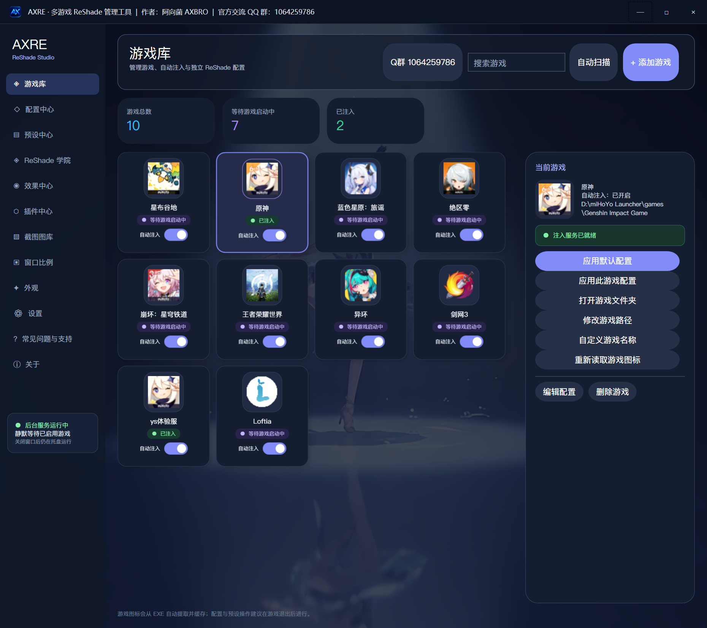
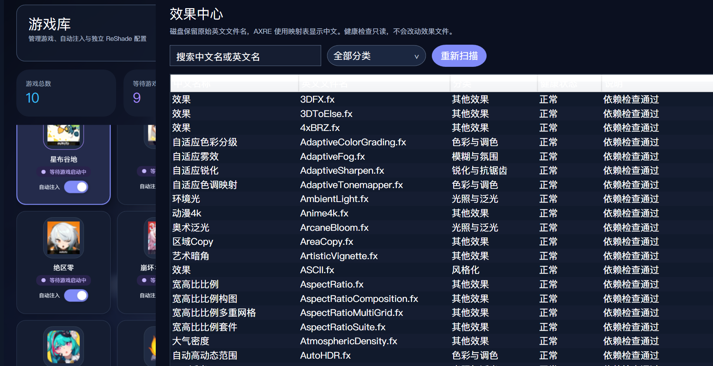
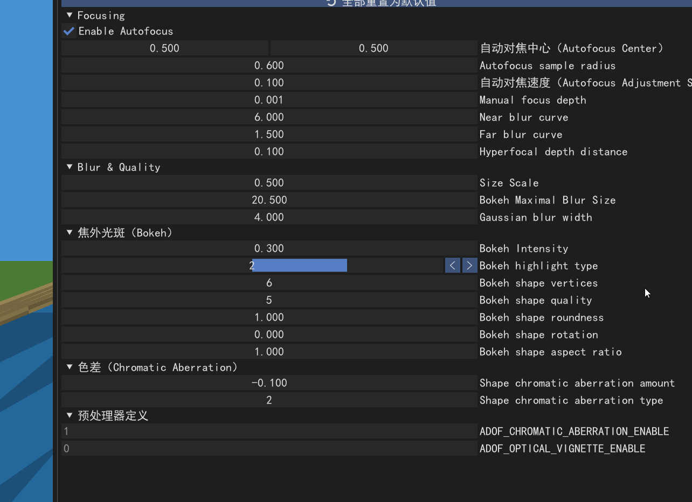
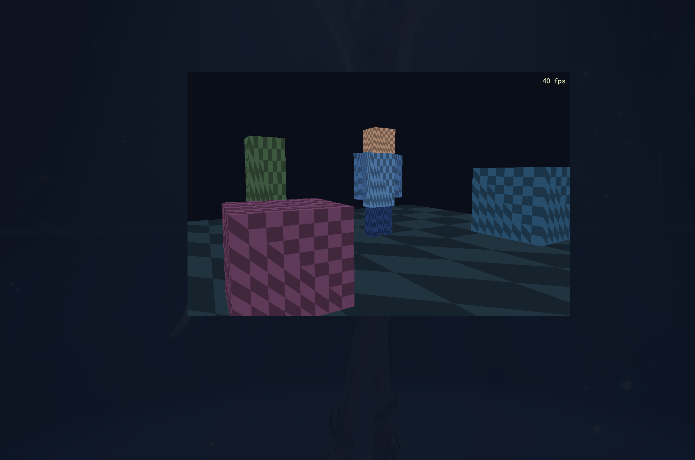

# 使用教程

[简体中文](USER-GUIDE.md) | [English](USER-GUIDE_EN.md)

## 游戏库

游戏卡片显示游戏名称、图标、注入状态和自动注入开关。右侧详情区域提供应用配置、打开游戏目录、修改路径、自定义名称和重新读取图标等操作。

## 效果中心与双语参数

效果中心不会改写效果算法，而是建立英文文件名、中文说明和参数翻译之间的映射。可以搜索中文名或英文名，并按需应用或撤销双语显示。

## 插件中心

插件中心用于查看 Add-on 的用途、来源、使用方式、启用状态和快捷键。关闭插件前应先退出游戏，避免配置在游戏退出时被覆盖。

## 截图图库

图库读取 ReShade 保存目录中的截图。若同一组同时包含原图和处理后图片，可以使用横向拖动对比；效果拆解截图会按组展示，便于逐项查看效果开启或关闭带来的变化。

## 调试场景

调试场景是轻量化的本地测试环境，用于观察色彩、锐化、景深和深度缓冲相关效果。它不能完全代表所有游戏引擎，但适合学习参数含义和快速排查效果。

## 配置迁移

将某游戏配置应用到另一游戏前，应确认：

- 两个游戏使用兼容的图形 API；
- 目标游戏已退出；
- 效果和贴图路径存在；
- 深度相关参数可能需要针对目标游戏重新调整。

## 深度问题

深度显示全白、全黑、颠倒或左右翻转时，先进入“常见问题与诊断”，选择对应游戏并尝试深度修正。多人联网游戏可能主动禁用深度访问，这是安全机制，不应尝试绕过。
